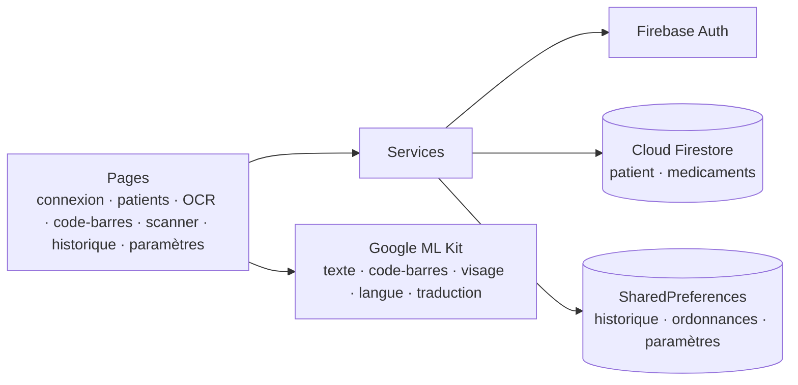

# 🩺 DME — Dossier Médical Électronique (Flutter)

> Application mobile multiplateforme qui aide un médecin à tenir ses **dossiers patients**, à **numériser les ordonnances papier** par OCR, à les **traduire** sur le téléphone, à **identifier les médicaments par code-barres** et à garder un **historique d'activité**, en français, anglais ou arabe.

🇬🇧 [English version](README.md)


-2E7D32)

---

## 📌 Présentation

Dans beaucoup de cabinets, ordonnances et notes patients restent sur papier. **DME** transforme le téléphone en petit système de dossiers numériques :

1. le médecin se connecte avec un compte Firebase ;
2. il crée ou met à jour des dossiers patients stockés dans **Cloud Firestore** ;
3. il photographie une ordonnance : le texte est extrait par **OCR**, sa langue est détectée, il peut être **traduit** et rattaché à un dossier patient ;
4. il scanne une boîte de médicament : le **code-barres** est recherché dans un catalogue partagé, ou ajouté ;
5. chaque action est inscrite dans un **historique** avec un badge de notifications non lues sur l'accueil.

Toute l'analyse d'image (OCR, codes-barres, visages, détection de langue, traduction) s'exécute **sur le téléphone** avec Google ML Kit : aucune image médicale n'est envoyée à un serveur.

## ✨ Fonctionnalités en détail

### 🔐 Authentification
- Inscription et connexion par **e-mail / mot de passe** (Firebase Authentication), avec des messages d'erreur traduits (utilisateur inconnu, mot de passe incorrect ou trop faible, e-mail déjà utilisé…).
- « Se souvenir de moi » : le dernier e-mail est pré-rempli.
- **Déverrouillage par visage** (optionnel, à activer dans les *Paramètres*) : quand une session est encore ouverte, l'application peut être rouverte en présentant un visage à la caméra. Il s'agit de *détection* de visage, pas de reconnaissance d'identité : il ne remplace jamais la connexion par mot de passe et il est refusé si aucun utilisateur n'est connecté.

### 👥 Dossiers patients
- Liste des patients sous forme de tableau, **ajout / modification / suppression** avec confirmation.
- Champs : nom, prénom, CIN, e-mail, téléphone, diagnostic.
- Stockés dans la collection Firestore `patient` ; chaque modification est inscrite dans l'historique.

### 📄 OCR d'ordonnance + traduction
- Prendre une photo ou choisir une image : texte extrait par **ML Kit Text Recognition**.
- **Identification de la langue** (FR / EN / AR) puis **traduction sur l'appareil** vers la langue choisie dans les *Paramètres*.
- Les ordonnances reconnues (original + traduction) sont conservées sur le téléphone et peuvent être rouvertes.
- **Créer un patient depuis une ordonnance** : nom et prénom sont lus dans les lignes contenant « nom » / « prénom », le texte complet devient le diagnostic ; le médecin confirme avant l'enregistrement.

### 💊 Scanner de codes-barres de médicaments
- Scan d'une boîte avec **ML Kit Barcode Scanning** : le code est recherché dans la collection Firestore `medicaments`.
- Code connu : nom et libellé s'affichent. Code inconnu : le médecin peut l'ajouter au catalogue en une fenêtre.

### 🤖 Scanner IA (écran de démonstration)
- Un écran pour essayer les trois modèles de vision : **analyse de visage** (nombre de visages, probabilité de sourire et d'yeux ouverts), **reconnaissance de texte** et **lecture de QR / codes-barres**.

### 🕑 Historique et notifications
- Journal horodaté des actions (patient ajouté / modifié / supprimé, ordonnances traduites…).
- Badge du nombre d'actions non lues sur l'accueil, remis à zéro à l'ouverture de l'historique.

### ⚙️ Paramètres et langues
- Interface en **français, anglais et arabe** (environ 100 textes traduits par langue, mise en page de droite à gauche en arabe), changement de langue sans redémarrage.
- Sons, notifications, déverrouillage par visage et langue cible de la traduction des ordonnances.

## 🧱 Architecture



```
lib/
├── main.dart            # initialisation Firebase, localisation, routes
├── config/              # définition du menu de navigation
├── menu/                # tiroir (avec déconnexion)
├── model/               # Patient, Medicament + mapping Firestore
├── pages/               # 10 écrans
└── services/            # CRUD Firestore, déverrouillage par visage, historique, langue, traductions de l'interface
test/                    # tests unitaires des modèles
```

| Couche | Technologie |
|---|---|
| Interface | Flutter (Material), `flutter_localizations` |
| Authentification | Firebase Authentication |
| Données | Cloud Firestore, SharedPreferences |
| IA embarquée | ML Kit Text Recognition, Barcode Scanning, Face Detection, Language ID, Translation |
| Médias | `image_picker` (caméra / galerie) |

## 🚀 Installation

Prérequis : [SDK Flutter](https://docs.flutter.dev/get-started/install) 3.x et un appareil ou émulateur Android (les fonctions ML Kit nécessitent Android ou iOS).

```bash
git clone https://github.com/MohamedTrikii/dme_project_flutter.git
cd dme_project_flutter
flutter pub get
flutter run
```

**Utiliser votre propre projet Firebase** (recommandé) :

```bash
dart pub global activate flutterfire_cli
flutterfire configure          # régénère lib/firebase_options.dart et google-services.json
```

Dans la console Firebase, activez ensuite la connexion **E-mail/Mot de passe** et créez une base **Firestore** (les collections `patient` et `medicaments` sont créées automatiquement).

## ✅ Qualité

```bash
flutter analyze   # No issues found
flutter test      # tests unitaires des modèles
```

## ⚠️ Limites et pistes

- Le déverrouillage détecte un visage mais ne vérifie pas *à qui* il appartient (pas d'empreinte faciale) ; une vraie vérification biométrique utiliserait l'API biométrique du téléphone.
- L'extraction du nom et du prénom depuis l'ordonnance repose sur des règles (mots-clés « nom » / « prénom »).
- L'historique et les ordonnances enregistrées restent sur le téléphone ; les synchroniser dans Firestore les rendrait disponibles sur tous les appareils.
- Avant tout usage réel, les règles de sécurité Firestore doivent limiter chaque médecin à ses propres patients.

## 👤 Auteur

**Mohamed Triki** — [GitHub](https://github.com/MohamedTrikii)
