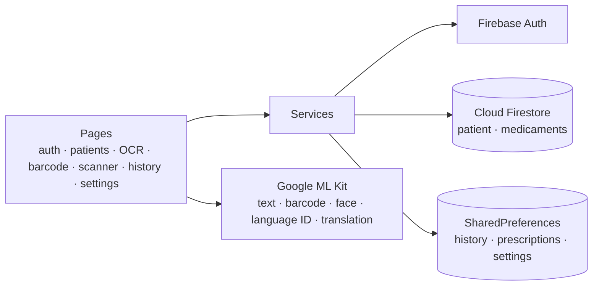

# 🩺 DME — Electronic Medical Record (Flutter)

> A cross-platform mobile app that helps a doctor keep **patient records**, **digitise paper prescriptions** with OCR, **translate** them on the device, **identify medicines by barcode** and keep an **activity log** — in French, English or Arabic.

🇫🇷 [Version française](README.fr.md)


-2E7D32)

---

## 📌 Overview

In many practices, prescriptions and patient notes still live on paper. **DME** (*Dossier Médical Électronique*) turns the phone into a small digital record system:

1. the doctor signs in with a Firebase account;
2. creates or updates patient records stored in **Cloud Firestore**;
3. photographs a prescription → the text is extracted with **OCR**, its language is detected, it can be **translated** and attached to a patient record;
4. scans a medicine box → the **barcode** is looked up in a shared medicine catalogue, or added to it;
5. every action is written to an **activity history** with an unread-notification badge on the home screen.

All image analysis (OCR, barcodes, faces, language detection, translation) runs **on the device** with Google ML Kit: no medical image is sent to a server.

## ✨ Features in detail

### 🔐 Authentication
- Sign-up and login with **email / password** (Firebase Authentication), with clear translated error messages (unknown user, wrong password, weak password, email already used…).
- "Remember me": the last email is pre-filled.
- **Face unlock** (optional, enabled in *Settings*): when a session is still open, the app can be reopened by showing a face to the camera. It uses face *detection*, not identity recognition, so it never replaces the password login and is refused when no user is signed in.

### 👥 Patient records
- List of patients in a data table, **add / edit / delete** with confirmation.
- Fields: last name, first name, national ID (CIN), email, phone, diagnosis.
- Stored in the Firestore collection `patient`; every change is logged in the history.

### 📄 Prescription OCR + translation
- Take a photo or pick an image → text extracted with **ML Kit Text Recognition**.
- **Language identification** (FR / EN / AR) then **on-device translation** into the language chosen in *Settings*.
- Recognised prescriptions (original + translation) are kept on the device and can be re-opened.
- **Create a patient from a prescription**: name and first name are read from the lines containing "nom" / "prénom", the full text becomes the diagnosis; the doctor confirms before saving.

### 💊 Medicine barcode scanner
- Scan a box with **ML Kit Barcode Scanning** → the code is searched in the Firestore collection `medicaments`.
- Known code: name and label are displayed. Unknown code: the doctor can add it to the catalogue in one dialog.

### 🤖 AI scanner (demo screen)
- One screen to try the three vision models: **face analysis** (number of faces, smile and eye-open probabilities), **text recognition** and **QR / barcode reading**.

### 🕑 History & notifications
- Time-stamped log of actions (patient added / edited / deleted, prescriptions translated…).
- Badge with the number of unread actions on the home screen, reset when the history is opened.

### ⚙️ Settings & languages
- Interface in **French, English and Arabic** (≈ 100 translated strings per language, right-to-left layout in Arabic), switchable without restarting.
- Sounds, notifications, face unlock and the OCR translation target language.

## 🧱 Architecture



```
lib/
├── main.dart            # Firebase init, localisation delegates, routes
├── config/              # navigation menu definition
├── menu/                # drawer (with sign-out)
├── model/               # Patient, Medicament + Firestore mapping
├── pages/               # 10 screens
└── services/            # Firestore CRUD, face unlock, history, language, UI translations
test/                    # unit tests of the models
```

| Layer | Technology |
|---|---|
| UI | Flutter (Material), `flutter_localizations` |
| Auth | Firebase Authentication |
| Data | Cloud Firestore, SharedPreferences |
| On-device AI | ML Kit Text Recognition, Barcode Scanning, Face Detection, Language ID, Translation |
| Media | `image_picker` (camera / gallery) |

## 🚀 Getting started

Prerequisites: [Flutter SDK](https://docs.flutter.dev/get-started/install) 3.x and an Android device or emulator (ML Kit features need Android or iOS).

```bash
git clone https://github.com/MohamedTrikii/dme_project_flutter.git
cd dme_project_flutter
flutter pub get
flutter run
```

**Use your own Firebase project** (recommended):

```bash
dart pub global activate flutterfire_cli
flutterfire configure          # regenerates lib/firebase_options.dart and google-services.json
```

Then, in the Firebase console, enable **Email/Password** sign-in and create a **Firestore** database (collections `patient` and `medicaments` are created automatically).

## ✅ Quality

```bash
flutter analyze   # No issues found
flutter test      # model unit tests
```

## ⚠️ Limitations & ideas

- Face unlock detects a face but does not verify *whose* face it is (no face embedding); a real biometric check would use the platform biometrics API.
- Name / first-name extraction from prescriptions is rule-based (keywords "nom" / "prénom").
- History and saved prescriptions are local to the device; syncing them to Firestore would make them available on every device.
- Firestore security rules should restrict each doctor to their own patients before any real use.

## 👤 Author

**Mohamed Triki** — [GitHub](https://github.com/MohamedTrikii)
